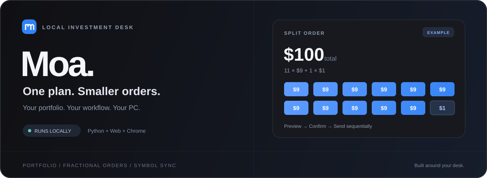
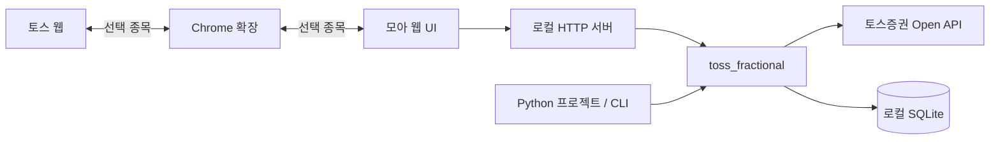

<div align="center">



# 모아 · Moa

**총액을 정하고, $9씩 나눠서.**

내 투자 조회부터 소수점 분할 주문까지, 내 PC에서 실행하는 투자 데스크.

[](https://github.com/haetae8554/moa-invest/actions/workflows/ci.yml)


[빠른 시작](#quick-start) · [주요 기능](#features) · [분할 방식](#splitting) · [Python 모듈](#module) · [보안](SECURITY.md) · [로드맵](ROADMAP.md)

</div>

---

모아는 **토스증권 Open API를 사용하는 독립 Python 모듈**, **로컬 웹 UI**, **Chrome 사이드 패널·종목 연결 확장**으로 구성됩니다. 토스 화면 옆에 두고 보유 종목을 살펴보거나, UI 없이 다른 Python 프로젝트에서 주문 모듈만 사용할 수 있습니다.

> [!NOTE]
> 토스증권의 공식 서비스가 아닌 독립 프로젝트입니다. 위 배너는 분할 방식의 예시이며 실제 계좌나 수익 내역을 표시하지 않습니다.

<a id="features"></a>

## 작은 화면에, 필요한 기능만

| | 기능 | 할 수 있는 일 |
| :---: | :--- | :--- |
| ◈ | **내 투자 한눈에** | 보유 종목·수량·평가금·손익 조회, 검색·정렬, 현재가/평가금 전환 |
| ↗ | **총액·총수량으로 계획** | 매수·매도를 선택하고 전체 주문 규모를 입력하면 약 $9씩 분할 |
| ▣ | **토스 옆 사이드 패널** | 별도 모아 탭 없이 내 투자·주문·API 키 설정. 패널 열기/닫기와 종목 연결 일시정지 |
| ⇄ | **토스 ↔ 모아 종목 연결** | 한쪽에서 고른 종목을 다른 화면에 반영. 종목별 수동 등록 없이 자동 조회 |
| ◐ | **내 환경에 맞는 테마** | 시스템·라이트·다크 모드와 좁은 창을 고려한 반응형 배치 |
| ⏸ | **진행 상황과 중단** | 주문별 접수 상태와 기록 확인, 아직 전송하지 않은 주문 중단 |
| ⌘ | **UI 없이도 사용** | 독립 Python 라이브러리와 CLI. 실행용 외부 패키지 의존성 없음 |

미국 주식의 소수점 분할 주문을 지원하며, 국내 주식은 보유 내역 조회 전용입니다.

<a id="quick-start"></a>

## 빠른 시작

**준비물:** Python 3.11 이상, Git, 본인의 토스증권 Open API 인증 정보. 종목 연결 확장을 쓰려면 Chrome이 필요합니다.

```powershell
git clone https://github.com/haetae8554/moa-invest.git
cd moa-invest
python -m order_ui.server --open
```

브라우저에서 [127.0.0.1:8765](http://127.0.0.1:8765)가 열립니다. Windows에서 `run.bat`을 더블클릭하면 서버만 실행합니다. 별도 탭을 열려면 위 명령 또는 `run.bat --open`을 사용하세요. 소스 폴더에서 실행할 때 별도의 패키지 설치는 필요하지 않습니다.

### 1. 화면에서 API 키 등록하기

**API 키 설정 → Client ID / Client Secret 입력 → 연결 확인 후 저장**을 누르세요. 계좌 조회로 유효성을 확인한 뒤 **모아 전용 Windows 자격 증명 관리자**에 두 값을 함께 저장합니다. 서버 재시작 없이 연결되며 입력칸은 비워집니다. 저장한 키를 다시 표시하는 기능은 없습니다.

등록된 모아 키가 있으면 기존 환경 설정보다 우선합니다. 등록된 키가 없을 때는 기존 `stock_llm_alert_project` Windows 저장 키나 환경 변수 설정을 사용할 수 있습니다. 다른 OS에서는 프로세스 환경 변수를 사용하세요. [설정 상세](docs/usage.md#api-키-등록)

> [!IMPORTANT]
> 키 검증을 시작하면 **실주문이 꺼지고 기존 미리보기가 만료**됩니다. 잘못된 키이면 기존 저장 키는 유지하지만 실주문은 자동으로 다시 켜지지 않습니다. 실행 중이거나 결과가 불확실한 주문이 있으면 변경을 막습니다. 저장 실패 시에도 주문을 차단하며, 키를 다시 등록해 복구할 수 있습니다. [보안 안내](SECURITY.md)

### 2. 토스 탭 옆에서 사용하기

1. **Chrome 141 이상**에서 `chrome://extensions` → **개발자 모드**를 켭니다.
2. **압축해제된 확장 프로그램 로드**에서 `browser_extension` 폴더를 선택합니다.
3. `run.bat`으로 로컬 서버를 실행합니다. 기본 실행은 추가 브라우저 탭을 열지 않습니다.
4. 토스 탭에서 모아 확장 아이콘 → **사이드 패널 열기**를 누릅니다.

패널에서 내 투자 조회·키 등록·주문을 사용할 수 있습니다. **패널 닫기**와 **종목 연결 켜짐/꺼짐**은 별도이며, 기존 두 탭 방식도 확장 메뉴에 남아 있습니다. 패널을 닫아도 이미 시작한 주문은 계속되므로 중단은 주문 기록에서 요청하세요.

> 기존 0.2.0 확장에서 업데이트할 때는 고정 확장 ID 적용을 위해 기존 확장을 제거한 뒤 폴더를 다시 로드하세요. 계좌 키·주문 기록은 로컬 서버에 남지만 확장의 탭 연결·종목 캐시는 초기화됩니다. Chrome 웹 스토어 배포는 준비 중입니다. [확장 설치·업데이트 안내](browser_extension/README.md)

### 3. 계획 확인 후 시작하기

**계좌·종목 선택 → 매수/매도 → 총금액/총수량 입력 → 미리보기 → 안내 확인 → 분할 주문 시작**

처음 실행할 때는 기본적으로 실주문이 꺼져 있습니다. 실제 전송에는 **실주문 모드 활성화와 미리보기 확인 후 시작**이 필요합니다. 이후 모드 선택은 로컬에 저장됩니다. 종목 선택이나 미리보기만으로는 주문을 보내지 않습니다.

<a id="splitting"></a>

## 한 번에 정하고, 나누어 전송

```text
총 주문금액 $100
       │
       ├── $9 × 11건  →  $99
       └── 마지막 1건 →   $1
                        ────
                    합계 $100 · 12건
```

| 방향 | 총금액으로 입력 | 총수량으로 입력 |
| :--- | :--- | :--- |
| **매수** | $9 금액 주문 + 마지막 잔액 | 미리보기 시세로 고정 예산을 계산한 뒤 금액 주문. 실제 매수 수량은 달라질 수 있음 |
| **매도** | $9 금액 주문 + 마지막 잔액 | 매 전송 직전 시세로 약 $9에 해당하는 수량을 계산. 마지막은 남은 수량 |

앱 자체의 하루 누적 주문 한도는 없습니다. 계좌의 주문 가능 금액·수량과 증권사 제한은 적용됩니다. $9는 분할 기준이며 **수수료 면제나 체결 결과를 보장하지 않습니다.** 실제 비용과 조건은 [토스증권 공식 수수료 안내](https://p.tossinvest.com/en/post?category=52&id=17106&type=notice)와 체결 내역을 확인하세요.

<details>
<summary><strong>주문 시작 전에 알아둘 동작</strong></summary>

- 미리보기는 **120초** 동안 유효합니다. 종목이나 실행 모드가 바뀌면 기존 미리보기는 무효화됩니다.
- **접수와 체결은 다릅니다.** 일부 주문만 접수된 뒤 중단될 수 있습니다.
- **남은 주문 중단**은 다음 전송을 멈춥니다. 이미 전송한 주문은 취소하지 않습니다.
- 브라우저를 닫아도 Python 서버가 실행 중이면 주문 전송이 계속됩니다. 서버 종료 후 자동 재개하지 않습니다.
- 결과를 확인할 수 없는 주문은 자동 재전송하지 않고 해당 계좌의 추가 전송을 차단합니다. 실제 주문 내역과 로컬 기록을 대조해야 합니다.

[분할 계산·실행 모드·상태 처리 상세 →](docs/usage.md)

</details>

<a id="module"></a>

## 화면은 가볍게, 모듈은 독립적으로



라이브러리는 UI를 import하지 않습니다. 확장은 선택 종목만 전달하며 주문을 실행하지 않습니다.

```powershell
# 다른 Python 프로젝트에서 사용할 때, 이 저장소 경로에서 설치
python -m pip install .
```

```python
from toss_fractional import Settings, create_service

# 환경 변수 또는 기존 Windows 자격 증명에서 인증 정보를 읽습니다.
service = create_service(Settings.from_env())

preview = service.preview_batch(
    "AAPL", "100.00",
    account_seq="your-account-seq",
    side="BUY",        # BUY / SELL
    basis="AMOUNT",    # AMOUNT / QUANTITY
)
# 미리보기만 생성합니다. 실제 주문은 전송하지 않습니다.
```

실행·중단 메서드, `.env` 로딩, 브로커 주입과 CLI 명령은 [사용 가이드](docs/usage.md)에서 확인할 수 있습니다.

## 내 PC에 남는 데이터

| 대상 | 현재 처리 방식 |
| :--- | :--- |
| **API 키** | 로컬 화면에서 등록 → 모아 전용 Windows 저장소에 한 쌍으로 저장. 응답·로그·브라우저 저장소에 키를 남기지 않음 |
| **OAuth 토큰** | 기본적으로 메모리에만 보관. 명시적으로 설정한 호환용 파일 캐시는 평문이므로 별도 보호 필요 |
| **주문 기록** | 로컬 SQLite에 저장. DB·로그·실제 `.env`는 Git 제외 |
| **로컬 웹 서버** | `127.0.0.1`에서만 실행. Host·Origin·CSRF 검사 적용 |
| **Chrome 확장** | 종목 식별자만 연결. 계좌 정보와 API 키를 수집하지 않음 |

로컬 실행은 완전한 보안을 보장하지 않습니다. PC 접근 권한과 비밀 정보 관리 책임, 알려진 경계는 **[SECURITY.md](SECURITY.md)**에 정리했습니다.

## 개발과 기여

```text
moa-invest/
├── toss_fractional/     인증 · 계좌 · 시세 · 분할 주문 · 저장소
├── order_ui/            로컬 HTTP 서버와 웹 UI
├── browser_extension/   Chrome 종목 연결 확장
├── tests/               모의 브로커·브라우저 테스트
├── scripts/             공개 파일 검사
└── docs/                사용 가이드와 소개 이미지
```

```powershell
python -m unittest discover -s tests -v
node --test tests/test_symbol_sync.cjs
node --check order_ui/static/app.js
python scripts/check_public_tree.py
```

CI는 **Windows와 Linux**에서 Python·JavaScript 테스트와 공개 파일 검사를 실행합니다. 테스트는 모의 브로커를 사용하며 실제 주문·체결을 검증하지 않습니다. 커밋 전에는 `python scripts/check_public_tree.py --staged`로 공개 대상도 확인하세요.

오류 제보와 개선 제안은 [Issues](https://github.com/haetae8554/moa-invest/issues)에 남겨주세요. 재현 과정에 API 키·계좌번호·실제 자산 내역이 포함되지 않도록 확인해 주세요. 보안 문제는 [보안 제보 안내](SECURITY.md#reporting-a-vulnerability)를 따라주세요.

## 다음으로 만들 것

- [x] 독립 주문 모듈 · 로컬 UI · Chrome 종목 연결
- [x] 공개 저장소용 비밀 정보 제외 · CI 검사
- [x] 로컬 웹 화면에서 API 키 등록 및 Windows 자격 증명 관리자 저장
- [x] 별도 모아 탭이 필요 없는 Chrome 사이드 패널
- [ ] 설치·업데이트 흐름 개선
- [ ] Chrome 웹 스토어 배포 준비

[전체 개발 계획 →](ROADMAP.md)

---

<div align="center">

**Moa — Your local investment desk.**

[사용 가이드](docs/usage.md) · [확장 가이드](browser_extension/README.md) · [보안 안내](SECURITY.md) · [토스증권 Open API 스펙](https://openapi.tossinvest.com/openapi-docs/latest/openapi.json)

</div>
